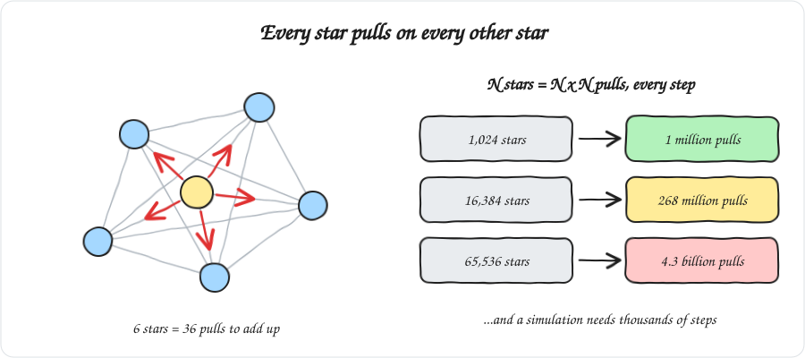
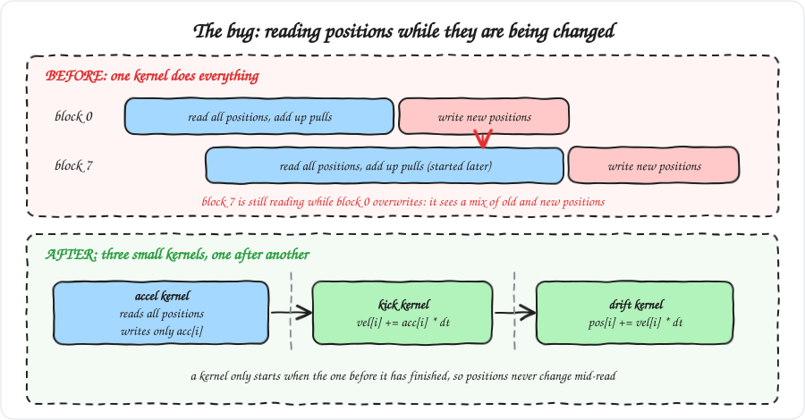
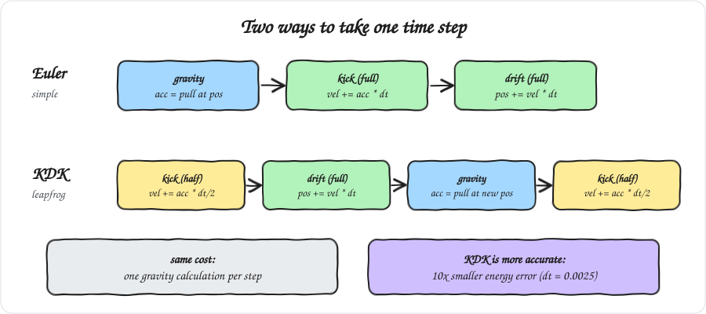
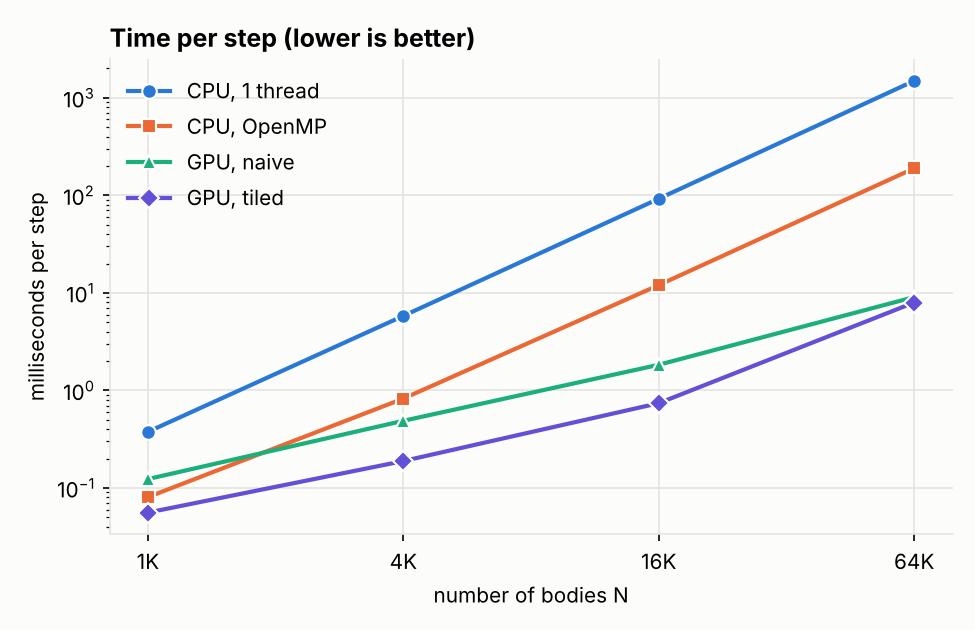
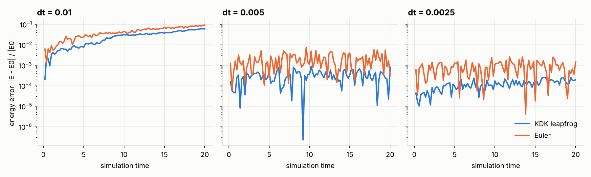
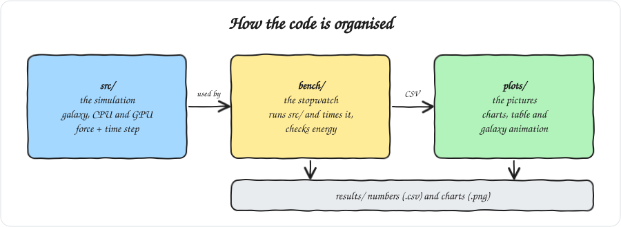

# Galaxy N-Body Simulation on the GPU

A small galaxy (one black hole, a disk of stars and a central bulge) where
every star feels the gravity of every other star. The same simulation is
written four ways so they can be compared:

| Version | Where it runs | File |
|---|---|---|
| CPU, 1 thread | one CPU core | `src/cpu_nbody.cpp` |
| CPU, OpenMP | all CPU cores | `src/cpu_nbody.cpp` |
| GPU, naive | NVIDIA GPU (CUDA) | `src/gpu_nbody.cu` |
| GPU, tiled | NVIDIA GPU (CUDA), using shared memory | `src/gpu_nbody.cu` |

**Headline result:** with 65,536 stars on an A100, the tiled GPU version takes
8 ms per step. One CPU thread takes 8.1 seconds. That is about 1,000x faster,
and 126x faster than 8 CPU threads.

---

## 1. The problem



To move the stars forward by one small time step, we need the total pull on
each star. That means looking at every pair of stars, so the work grows with
the **square** of the number of stars. Double the stars, four times the work.

## 2. The idea


The pull on star 1 does not depend on the pull on star 2, so they can be
computed at the same time. A GPU can run thousands of threads at once, so we
give each star its own thread.

---

## 3. Quick start

You need `g++`, `make` and, for the GPU parts, the CUDA toolkit (`nvcc`).

```bash
make
```

```bash
./build/galaxy_nbody
```

```bash
python3 plots/visualize.py simulation.bin
```

The second command simulates 4,096 stars for 5,000 steps on the GPU and saves
`simulation.bin`. The third one plays it as an animation
(`pip install numpy matplotlib` first).

No GPU? `make cpu` builds only the CPU programs.

---

## 4. How it works

### 4.1 The force loop

This is the whole physics, and it is the same on the CPU and the GPU:

```cpp
for (int j = 0; j < n; j++) {
    float dx = pos[j].x - pos[i].x;      // vector from star i to star j
    float dy = pos[j].y - pos[i].y;
    float dz = pos[j].z - pos[i].z;

    float dist_squared = dx*dx + dy*dy + dz*dz + SOFTENING_SQUARED;
    float inv_dist     = 1.0f / sqrt(dist_squared);
    float strength     = mass_j * inv_dist * inv_dist * inv_dist;

    ax += dx * strength;                 // add the pull of star j
    ay += dy * strength;
    az += dz * strength;
}
```

`SOFTENING_SQUARED` is a small number added so the force does not blow up when
two stars get very close.

### 4.2 A bug worth knowing: the race condition



The first version did everything in one kernel: compute the pull, then update
the position. But GPU blocks run in any order. One block could overwrite
positions while another was still reading them, so a star could feel some
neighbours at the old time and some at the new time. The result changed from
run to run.

**The fix:** split the step into small kernels. Positions are only written by
the `drift` kernel, and a kernel only starts after the previous one has
finished.

### 4.3 Naive vs tiled


Both GPU kernels compute exactly the same forces. They differ in how they
read the positions:

- **Naive:** every thread reads every position from global memory.
- **Tiled:** the threads of a block work as a team. Each thread copies one
  position into **shared memory** (small, fast memory that belongs to the
  block), so together they load a "tile" of 256 positions. Then all of them
  loop over that tile. Repeat for the next tile.

### 4.4 Euler vs KDK leapfrog



Once we know the pull (acceleration), we still have to move the stars. Two
methods are included:

- **Euler** is the simplest: use the pull for the whole step.
- **KDK** (kick-drift-kick, also called leapfrog) splits the velocity update
  into two halves, one before moving and one after. It costs the same but is
  noticeably more accurate.

A quick example: a ball on a spring starts at x = 1. After one step of 0.1 the
exact answer is x = 0.99500. Euler gives 0.99000. KDK gives 0.99500.

How do we know a simulation is accurate? **Total energy should stay constant.**
`bench/energy_drift.cpp` measures how much it changes.

---

## 5. Results

Measured on an **NVIDIA A100 (40 GB)** and 8 CPU cores of the same cloud
machine (Modal), on 2026-11-14, with `modal run bench/modal_bench.py`.

### Time per step



| N | version | ms per step | speedup | interactions / s | GFLOP/s |
|---|---|--:|--:|--:|--:|
| 1K | CPU, 1 thread | 1.994 | 1.0x | 0.5 billion | 11 |
| 1K | CPU, OpenMP | 0.276 | 7.2x | 3.8 billion | 76 |
| 1K | GPU, naive | 0.122 | 16.3x | 8.6 billion | 171 |
| 1K | GPU, tiled | 0.059 | 33.9x | 17.9 billion | 357 |
| 4K | CPU, 1 thread | 31.665 | 1.0x | 0.5 billion | 11 |
| 4K | CPU, OpenMP | 4.048 | 7.8x | 4.1 billion | 83 |
| 4K | GPU, naive | 0.479 | 66.1x | 35.0 billion | 700 |
| 4K | GPU, tiled | 0.198 | 159.9x | 84.7 billion | 1,694 |
| 16K | CPU, 1 thread | 506.093 | 1.0x | 0.5 billion | 11 |
| 16K | CPU, OpenMP | 64.155 | 7.9x | 4.2 billion | 84 |
| 16K | GPU, naive | 1.802 | 280.8x | 149.0 billion | 2,979 |
| 16K | GPU, tiled | 0.761 | 665.2x | 352.8 billion | 7,056 |
| 64K | CPU, 1 thread | 8122.282 | 1.0x | 0.5 billion | 11 |
| 64K | CPU, OpenMP | 1017.815 | 8.0x | 4.2 billion | 84 |
| 64K | GPU, naive | 11.227 | 723.5x | 382.6 billion | 7,651 |
| 64K | GPU, tiled | 8.061 | 1007.6x | 532.8 billion | 10,657 |

Speedup is against one CPU thread at the same N. GFLOP/s counts each
interaction as 20 floating point operations, which is the usual convention.

What this shows:

- **The GPU wins at every size, but by less at small N.** At 1K stars,
  starting a kernel costs about as much as the work itself: the naive kernel
  is only 2.3x faster than 8 CPU threads, and the tiled one 4.7x.
- **Large N: the GPU wins by a lot.** At 64K the tiled kernel is about 1,000x
  faster than one CPU thread and 126x faster than 8 threads.
- **The CPU is a plain loop.** One thread manages about 0.5 billion
  interactions per second (11 GFLOP/s). A hand-vectorised loop would be
  several times faster, so the speedups above are against simple C++, not
  against the best a CPU can do. OpenMP scales almost perfectly (8.0x on 8
  threads at 64K).
- **Tiling helps most in the middle.** Tiled is 2.1x to 2.4x faster than
  naive up to 16K, but only 1.4x at 64K.

### Block size


The block size is the number of threads per block, and for the tiled kernel
it is also the tile size. **128 is best for the tiled kernel at 1K, 4K and
64K, and 256 at 16K.** 512 is always the slowest choice for the tiled kernel,
up to 2.1x slower. The naive kernel prefers small blocks (64 or 128).

### Why is tiled faster? (Nsight Compute)

One force calculation, profiled with NVIDIA's profiler:

| | naive, 16K | tiled, 16K | naive, 64K | tiled, 64K |
|---|--:|--:|--:|--:|
| Bytes loaded from global memory | 1.07 GB | 68 MB | 17.2 GB | 1.08 GB |
| Shared memory accesses | ~0 | 17 million | ~0 | 271 million |
| Compute units busy (% of peak) | 25% | 48% | 55% | 71% |
| Occupancy possible | 100% | 100% | 100% | 100% |
| Occupancy achieved | 12.5% | 12.5% | 26.7% | 23.2% |

Tiling cuts global memory loads by **16x** and replaces them with shared
memory accesses. With less waiting on memory, the compute units are busier
(25% to 48% at 16K). At 64K the naive kernel is already at 55%, so there is
less left to gain, which matches the smaller 1.4x speedup above.

### Energy conservation



Largest energy error during a run of 1,024 stars for 20 time units:

| time step dt | KDK | Euler |
|--:|--:|--:|
| 0.01 | 8.3% | 6.9% |
| 0.005 | 0.13% | 0.64% |
| 0.0025 | 0.029% | 0.22% |

- **KDK is 5x to 8x more accurate than Euler** once the time step is small
  enough. At dt = 0.01 neither is accurate, and KDK happens to end up worse.
- **The default dt = 0.01 is too big for accurate work.** Stars that pass
  close to the black hole move too far in one step. Use
  `./build/galaxy_nbody 4096 20000 kdk 0.0025` when accuracy matters.

---

## 6. How the code is organised



```
src/                      THE SIMULATION
  types.h                   Vec4 and the softening constant
  galaxy.h / .cpp           builds the starting galaxy
  cpu_nbody.h / .cpp        CPU version: forces, Euler step, KDK step, energy
  gpu_nbody.h / .cu         GPU version: naive kernel, tiled kernel, kick, drift
  main.cu                   runs the galaxy on the GPU, writes simulation.bin

bench/                    THE STOPWATCH
  bench_cpu.cpp             times the CPU version
  bench_gpu.cu              times the GPU version
  check_gpu.cu              checks that GPU forces match CPU forces
  energy_drift.cpp          measures the energy error of KDK and Euler
  run_benchmarks.sh         runs all of the above, writes results/*.csv
  profile_ncu.sh            Nsight Compute profile of the two GPU kernels
  modal_bench.py            runs everything on a rented cloud GPU (Modal)

plots/                    THE PICTURES
  plot_results.py           results/*.csv -> charts and a Markdown table
  visualize.py              simulation.bin -> galaxy animation

results/                  numbers (.csv) and charts (.png)
images/                   the diagrams in this README
```

## 7. Reproduce the results

On a machine with an NVIDIA GPU:

```bash
bash bench/run_benchmarks.sh
```

```bash
bash bench/profile_ncu.sh
```

```bash
python3 plots/plot_results.py
```

Or on a rented GPU with [Modal](https://modal.com):

```bash
modal run bench/modal_bench.py
```

Each benchmark program can also be run by hand:

```bash
./build/bench_gpu tiled 65536 256 30
```

```bash
./build/bench_cpu omp 16384 10
```

```bash
./build/energy_drift kdk 0.005
```

```bash
./build/check_gpu
```

## 8. Good to know

- Timings come from a shared cloud machine and vary by roughly 20% from run
  to run.
- The simulation uses single precision (`float`). Only the energy check uses
  `double`.
- This is "direct summation": simple and exact, but the N x N cost limits it
  to around 100K stars. Larger simulations use tree or grid methods.
