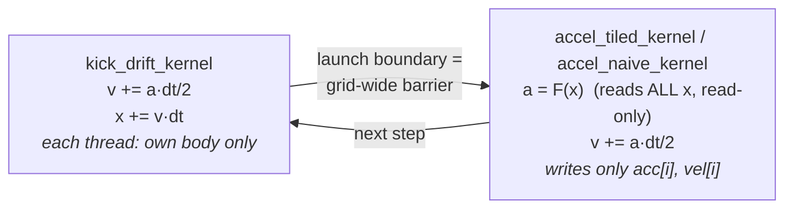
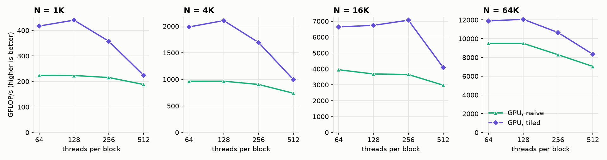

# Parallel N-Body Simulation (CUDA + C++/OpenMP)

GPU-accelerated N-body gravitational simulation of a Milky Way-like galaxy,
with CPU baselines, energy-conservation checks, benchmarks and profiling.

| Solver | Where | Complexity | Source |
|---|---|---|---|
| Direct sum, single thread (SIMD-vectorised) | CPU | O(N²) | `nbody/src/cpu_nbody.cpp` |
| Direct sum, OpenMP | CPU | O(N²) | `nbody/src/cpu_nbody.cpp` |
| Barnes–Hut octree, θ = 0.5, OpenMP | CPU | O(N log N) | `nbody/src/cpu_nbody.cpp` |
| Direct sum, **naive** kernel (global memory) | GPU | O(N²) | `nbody/src/nbody_kernel.cu` |
| Direct sum, **tiled** kernel (shared memory) | GPU | O(N²) | `nbody/src/nbody_kernel.cu` |

All of them use the same initial conditions, the same Plummer softening
(ε = 0.02) and the same **kick-drift-kick leapfrog** integrator, so the
timings and energy figures compare like with like.

## Project structure

```
├── nbody/
│   ├── src/
│   │   ├── common.h                    vec4, Energy, constants (CPU + GPU)
│   │   ├── galaxy_ics.{h,cpp}          galaxy initial conditions
│   │   ├── cpu_nbody.{h,cpp}           serial / OpenMP / Barnes–Hut + energy
│   │   ├── nbody_kernel.{cuh,cu}       CUDA kernels: naive, tiled, KDK, energy
│   │   ├── galaxy_simulation.{cuh,cu}  GPU time loop, snapshots, energy log
│   │   ├── main.cu                     galaxy_nbody (simulation + visualisation output)
│   │   ├── bench_gpu.cu                nbody_bench_gpu  (CSV benchmark row)
│   │   └── bench_cpu.cpp               nbody_bench_cpu  (CSV benchmark row)
│   ├── CMakeLists.txt                  CPU targets always; CUDA targets if nvcc found
│   ├── build.sh                        nvcc/g++ build without CMake
│   ├── visualize.py                    animation of simulation.bin
│   └── README.md                       build / run / physics details
├── scripts/
│   ├── run_benchmarks.sh               all benchmarks → results/*.csv
│   ├── profile_ncu.sh                  Nsight Compute naive vs tiled → results/ncu_metrics.csv
│   ├── make_report.py                  results/*.csv → charts + the section below
│   └── modal_bench.py                  run all of the above on one Modal A100 container
└── results/                            measured data and charts
```

## Quick start

```bash
cd nbody
cmake -S . -B build && cmake --build build -j
./build/galaxy_nbody                 # 4096 bodies, 5000 KDK steps → simulation.bin, energy.csv
python3 visualize.py simulation.bin
```

Reproduce every number below (GPU sections run only if a GPU is visible):

```bash
scripts/run_benchmarks.sh
```

```bash
scripts/profile_ncu.sh
```

```bash
python3 scripts/make_report.py
```

No local GPU? The same pipeline runs on one [Modal](https://modal.com) A100
container (CPU + GPU + Nsight Compute + report, about 15 minutes), which is
how the numbers below were produced:

```bash
modal run scripts/modal_bench.py
```

## How one timestep works on the GPU



**The race this replaces.** The original code had one kernel that computed
the force *and* then wrote `pos[i]`. Blocks run in no fixed order, so while
block 0 was writing its new positions, block 7 could still be loading a tile
that included them. Body *i* then felt some bodies at time *t* and others at
*t + dt*, and the result depended on scheduling. Now no kernel writes the
array it reads from all threads: positions only change in `kick_drift_kernel`,
and the kernel launch boundary guarantees every block finished reading first.

**The integrator.** The original update `v += a·dt; x += v·dt` was
semi-implicit (symplectic) Euler, which is first order. It is now a real
kick-drift-kick leapfrog (second order, time-reversible) that still needs only
one force evaluation per step, because `a(x_{n+1})` from the end of one step
is reused as the first half-kick of the next. Euler stays available
(`--integrator euler`) so the two can be compared.

**Example, one body, dt = 0.1, a = −x (spring):** starting at x = 1, v = 0,
Euler gives v₁ = −0.1, x₁ = 0.99. KDK gives v½ = −0.05, x₁ = 0.995,
v₁ = −0.05 − 0.995·0.05 = −0.09975. The exact answer is
x = cos 0.1 = 0.99500, v = −sin 0.1 = −0.09983. KDK's position error is
5·10⁻⁶; Euler's is 5·10⁻³.

## Results

<!-- RESULTS:BEGIN -->
_Generated by `scripts/make_report.py` from `results/*.csv` — do not edit by hand._

**Hardware:** CPU x86-64 (model name hidden by the Modal sandbox) [AVX2] (8 threads), GPU NVIDIA A100-SXM4-40GB, 8.0, 610.57.04

### Direct summation: time per step, speedup, throughput

One step = one force evaluation (N² interactions) + one KDK integration kernel. GFLOP/s uses the 20 FLOP/interaction convention. Speedup is against the single-thread CPU code at the same N.

| N | implementation | ms / step | speedup vs serial | interactions / s | GFLOP/s | ΔE/E₀ (run) |
|---|---|--:|--:|--:|--:|--:|
| 1K | CPU serial (1 thread, SIMD) | 0.377 | 1.0× | 2.78 G/s | 55.6 | — |
|  | CPU OpenMP | 0.081 | 4.7× | 13.00 G/s | 260.0 | — |
|  | GPU naive | 0.124 | 3.1× | 8.49 G/s | 169.7 | 1.9e-02 |
|  | GPU tiled (shared mem) | 0.056 | 6.7× | 18.72 G/s | 374.3 | 1.9e-02 |
| 4K | CPU serial (1 thread, SIMD) | 5.815 | 1.0× | 2.88 G/s | 57.7 | — |
|  | CPU OpenMP | 0.826 | 7.0× | 20.31 G/s | 406.2 | — |
|  | GPU naive | 0.489 | 11.9× | 34.34 G/s | 686.7 | 5.2e-03 |
|  | GPU tiled (shared mem) | 0.189 | 30.8× | 88.75 G/s | 1,774.9 | 5.2e-03 |
| 16K | CPU serial (1 thread, SIMD) | 92.4 | 1.0× | 2.91 G/s | 58.1 | — |
|  | CPU OpenMP | 12.0 | 7.7× | 22.32 G/s | 446.4 | — |
|  | GPU naive | 1.834 | 50.4× | 146.36 G/s | 2,927.2 | 5.1e-04 |
|  | GPU tiled (shared mem) | 0.741 | 124.7× | 362.25 G/s | 7,245.0 | 5.1e-04 |
| 64K | CPU serial (1 thread, SIMD) | 1,493.3 | 1.0× | 2.88 G/s | 57.5 | — |
|  | CPU OpenMP | 189.5 | 7.9× | 22.67 G/s | 453.4 | — |
|  | GPU naive | 9.061 | 164.8× | 474.00 G/s | 9,480.0 | 7.5e-04 |
|  | GPU tiled (shared mem) | 7.973 | 187.3× | 538.68 G/s | 10,773.5 | 7.5e-04 |


### GPU block-size sweep

| N | kernel | block 64 | block 128 | block 256 | block 512 |
|---|---|--:|--:|--:|--:|
| 1K | GPU naive | 185 | 188 | 186 | **205** |
| 1K | GPU tiled (shared mem) | 467 | **486** | 407 | 211 |
| 4K | GPU naive | 602 | 741 | **752** | 736 |
| 4K | GPU tiled (shared mem) | 2,059 | **2,164** | 1,784 | 1,019 |
| 16K | GPU naive | **2,972** | 2,539 | 2,349 | 2,224 |
| 16K | GPU tiled (shared mem) | 5,333 | 5,350 | **5,660** | 3,208 |
| 64K | GPU naive | 8,936 | **11,518** | 9,468 | 7,672 |
| 64K | GPU tiled (shared mem) | 11,986 | **12,167** | 10,784 | 8,353 |

GFLOP/s; best block size per row in bold.



### Nsight Compute: naive vs tiled

| metric | GPU naive N=16K | GPU tiled (shared mem) N=16K | GPU naive N=64K | GPU tiled (shared mem) N=64K |
|---|--:|--:|--:|--:|
| kernel time [ns] | 2159200 | 829888 | 9042656 | 10250240 |
| compute throughput (% peak) | 19.46 | 48.83 | 63.20 | 71.92 |
| memory throughput (% peak) | 11.98 | 15.29 | 38.90 | 22.50 |
| DRAM throughput (% peak) | 0.02 | 0.04 | 0.01 | 0.01 |
| L2 traffic [byte] | 19037376 | 18941472 | 140265152 | 277734080 |
| global-load bytes (L1) [byte] | 268959744 | 17301504 | 4297064448 | 270532608 |
| shared-mem wavefronts | 512 | 16916992 | 2048 | 270665728 |
| achieved occupancy (%) | 12.50 | 12.50 | 28.78 | 23.45 |
| theoretical occupancy (%) | 100 | 100 | 100 | 100 |
| registers / thread [register/thread] | 32 | 32 | 32 | 32 |
| stall: long scoreboard (cyc) | — | — | — | — |
| stall: barrier (cyc) | — | — | — | — |

### Energy conservation

| integrator | dt | steps | final ΔE/E₀ | max abs(ΔE/E₀) |
|---|--:|--:|--:|--:|
| KDK leapfrog | 0.01 | 2000 | +5.91e-02 | 6.09e-02 |
| KDK leapfrog | 0.005 | 4000 | -7.94e-04 | 8.86e-04 |
| KDK leapfrog | 0.0025 | 8000 | -1.95e-04 | 2.60e-04 |
| semi-implicit Euler | 0.01 | 2000 | +9.11e-02 | 9.11e-02 |
| semi-implicit Euler | 0.005 | 4000 | +3.04e-04 | 7.33e-03 |
| semi-implicit Euler | 0.0025 | 8000 | +1.43e-03 | 2.58e-03 |


### Barnes–Hut vs direct summation (CPU)

| N | direct, 1 thread | Barnes–Hut, 1 thread | direct, OpenMP | Barnes–Hut, OpenMP | BH force error (RMS) |
|---|--:|--:|--:|--:|--:|
| 256 | 0.026 | 0.184 | 0.017 | 0.089 | 0.41 % |
| 512 | 0.098 | 0.490 | 0.032 | 0.151 | 0.49 % |
| 1K | 0.374 | 1.557 | 0.078 | 0.383 | 0.80 % |
| 2K | 1.479 | 4.057 | 0.236 | 0.861 | 0.90 % |
| 4K | 5.820 | 9.665 | 0.835 | 1.869 | 0.90 % |
| 8K | 23.1 | 26.0 | 3.082 | 4.572 | 1.07 % |
| 16K | 92.2 | 73.9 | 11.8 | 11.7 | 1.12 % |
| 32K | 369.4 | 190.8 | 47.6 | 28.5 | 1.09 % |
| 64K | 1,490.6 | 506.9 | 189.0 | 72.6 | 1.09 % |
| 128K | 5,956.8 | 1,226.5 | 755.9 | 168.5 | 1.11 % |

ms per step. **Crossover** (Barnes–Hut faster than direct summation on the same threads): 1 thread **N ≈ 10,459**, OpenMP **N ≈ 16,122**.


<!-- RESULTS:END -->

### Reading the results

- **Direct sum on the CPU is a strong baseline.** The single-thread code is
  SIMD-vectorised (AVX2 on the test machine), so "speedup vs serial" for
  the GPU means speedup over a vectorised core, not over scalar code. CPU and
  GPU numbers come from the same container, so the speedups are same-host.
- **The GPU wins from N ≈ 4K and the gap grows with N.** At N = 1K the launch
  overhead dominates and 8 OpenMP threads beat the naive kernel. At N = 64K
  the tiled kernel takes 8.0 ms per step: 187× the vectorised serial code and
  24× the 8-thread OpenMP code. Peak throughput is about 12,200 GFLOP/s
  (N = 64K, block 128).
- **Shared-memory tiling pays most at mid N.** Tiled is 2.2–2.6× faster than
  naive from 1K to 16K, but only 1.14× at 64K. Nsight Compute shows what
  tiling changes: global loads through L1 fall 16× (4.30 GB → 0.27 GB per
  force evaluation at 64K) and are replaced by shared-memory accesses, and
  compute throughput rises from 19 % to 49 % of peak at 16K. At 64K the naive
  kernel already reaches 63 % of peak compute, so there is less left to gain.
- **Block size matters more for the tiled kernel.** The tile is one block, so
  block size sets how many bodies sit in shared memory. 128 is best or near
  best at most N; 512 is always the slowest tiled choice, up to 2.3× slower.
- **Energy drift on the GPU matches the CPU.** The ΔE/E₀ column is identical
  for the naive and tiled kernels at every N: they compute the same forces.
- **Energy drift is set by the timestep, not by the parallelisation.** At the
  default `dt = 0.01` both integrators drift by several percent over 20 time
  units, because bulge stars that pass the softened black hole have an orbital
  timescale √(ε³/M_bh) ≈ 0.013, about one step. Once dt resolves that
  (0.005 and below), both schemes stop drifting secularly, since both are
  symplectic, and the error becomes a bounded oscillation. KDK's oscillation
  shrinks about 4–8× per halving of dt (second order), while Euler's shrinks
  only about 2× (first order). At dt = 0.0025, KDK stays near 10⁻⁴ and Euler
  near 10⁻³. For quantitative runs, use `--dt 0.0025` or a larger softening.
- **Barnes–Hut** has a fixed cost per body (tree build, stack traversal) that is
  far higher than one vectorised direct interaction, so it only wins at fairly
  large N: N ≈ 10K on one thread and N ≈ 16K on 8 threads. Against the GPU
  direct kernel the crossover is beyond the measured range: at N = 64K the
  tiled GPU kernel (8.0 ms) is still 9× faster than 8-thread Barnes–Hut
  (72.6 ms), which also carries a ~1 % force error.
- **Caveats.** Everything was measured in a Modal cloud container (A100-SXM4-40GB,
  8 reserved cores of a 24-core AMD host; the sandbox hides the CPU model
  name). Timings on shared hardware vary by roughly ±20 % between runs. Nsight
  Compute ran with `--clock-control none` because the container cannot lock
  GPU clocks, so its single-launch kernel times are noisier than the benchmark
  averages (at 64K it timed tiled slower than naive, the opposite of the
  20-step average); the stall metrics were not reported by this ncu version.
