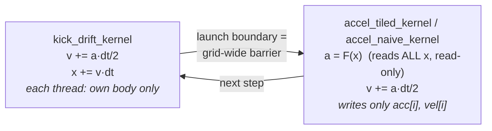
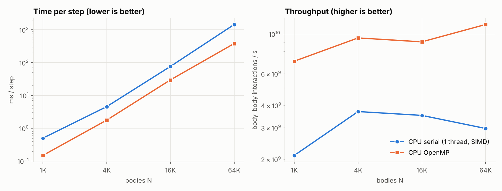
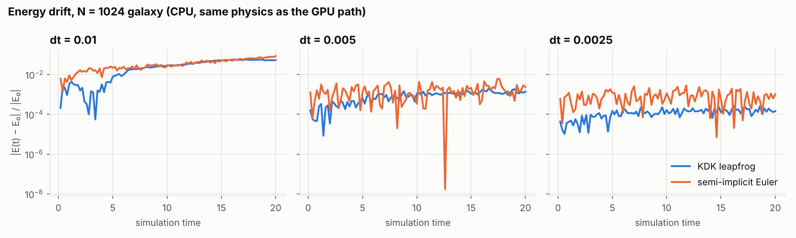
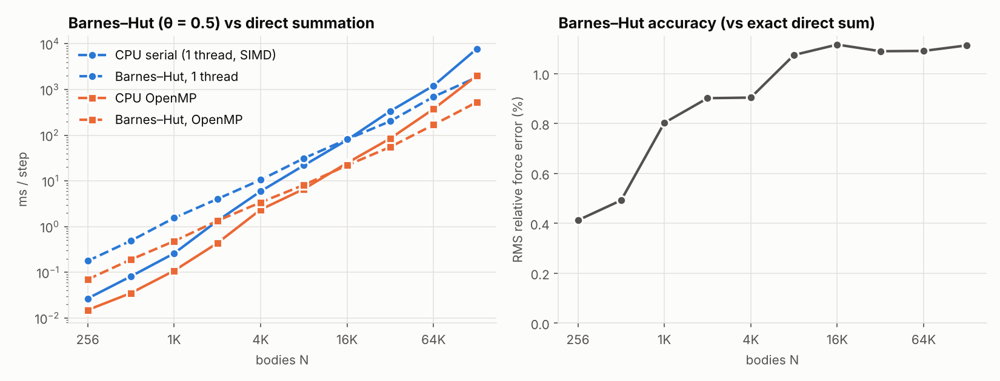

# Parallel N-Body Simulation (CUDA + C++/OpenMP)

[](https://colab.research.google.com/github/colmeabhi/parallelized-nbody-simulation-cuda-cpp/blob/main/notebooks/colab_gpu_benchmarks.ipynb)

GPU-accelerated N-body gravitational simulation of a Milky Way-like galaxy,
with CPU baselines, energy-conservation checks, benchmarks and profiling.

| Solver | Where | Complexity | Source |
|---|---|---|---|
| Direct sum, single thread (SIMD-vectorised) | CPU | O(N²) | `nbody/src/cpu_nbody.cpp` |
| Direct sum, OpenMP | CPU | O(N²) | `nbody/src/cpu_nbody.cpp` |
| Barnes–Hut octree, θ = 0.5, OpenMP | CPU | O(N log N) | `nbody/src/cpu_nbody.cpp` |
| Direct sum, **naive** kernel (global memory) | GPU | O(N²) | `nbody/src/nbody_kernel.cu` |
| Direct sum, **tiled** kernel (shared memory) | GPU | O(N²) | `nbody/src/nbody_kernel.cu` |

All of them use the same initial conditions, the same Plummer softening
(ε = 0.02) and the same **kick-drift-kick leapfrog** integrator, so the
timings and energy figures compare like with like.

## Project structure

```
├── nbody/
│   ├── src/
│   │   ├── common.h                    vec4, Energy, constants (CPU + GPU)
│   │   ├── galaxy_ics.{h,cpp}          galaxy initial conditions
│   │   ├── cpu_nbody.{h,cpp}           serial / OpenMP / Barnes–Hut + energy
│   │   ├── nbody_kernel.{cuh,cu}       CUDA kernels: naive, tiled, KDK, energy
│   │   ├── galaxy_simulation.{cuh,cu}  GPU time loop, snapshots, energy log
│   │   ├── main.cu                     galaxy_nbody (simulation + visualisation output)
│   │   ├── bench_gpu.cu                nbody_bench_gpu  (CSV benchmark row)
│   │   └── bench_cpu.cpp               nbody_bench_cpu  (CSV benchmark row)
│   ├── CMakeLists.txt                  CPU targets always; CUDA targets if nvcc found
│   ├── build.sh                        nvcc/g++ build without CMake
│   ├── visualize.py                    animation of simulation.bin
│   └── README.md                       build / run / physics details
├── scripts/
│   ├── run_benchmarks.sh               all benchmarks → results/*.csv
│   ├── profile_ncu.sh                  Nsight Compute naive vs tiled → results/ncu_metrics.csv
│   └── make_report.py                  results/*.csv → charts + the section below
├── notebooks/colab_gpu_benchmarks.ipynb  run it all on a free Colab GPU
└── results/                            measured data and charts
```

## Quick start

```bash
cd nbody
cmake -S . -B build && cmake --build build -j
./build/galaxy_nbody                 # 4096 bodies, 5000 KDK steps → simulation.bin, energy.csv
python3 visualize.py simulation.bin
```

No GPU? [`notebooks/colab_gpu_benchmarks.ipynb`](notebooks/colab_gpu_benchmarks.ipynb) builds and benchmarks everything on a free Colab T4 (badge above).

Reproduce every number below (GPU sections run only if a GPU is visible):

```bash
scripts/run_benchmarks.sh
```

```bash
scripts/profile_ncu.sh
```

```bash
python3 scripts/make_report.py
```

## How one timestep works on the GPU



**The race this replaces.** The original code had one kernel that computed
the force *and* then wrote `pos[i]`. Blocks run in no fixed order, so while
block 0 was writing its new positions, block 7 could still be loading a tile
that included them. Body *i* then felt some bodies at time *t* and others at
*t + dt*, and the result depended on scheduling. Now no kernel writes the
array it reads from all threads: positions only change in `kick_drift_kernel`,
and the kernel launch boundary guarantees every block finished reading first.

**The integrator.** The original update `v += a·dt; x += v·dt` was
semi-implicit (symplectic) Euler, which is first order. It is now a real
kick-drift-kick leapfrog (second order, time-reversible) that still needs only
one force evaluation per step, because `a(x_{n+1})` from the end of one step
is reused as the first half-kick of the next. Euler stays available
(`--integrator euler`) so the two can be compared.

**Example, one body, dt = 0.1, a = −x (spring):** starting at x = 1, v = 0,
Euler gives v₁ = −0.1, x₁ = 0.99. KDK gives v½ = −0.05, x₁ = 0.995,
v₁ = −0.05 − 0.995·0.05 = −0.09975. The exact answer is
x = cos 0.1 = 0.99500, v = −sin 0.1 = −0.09983. KDK's position error is
5·10⁻⁶; Euler's is 5·10⁻³.

## Results

<!-- RESULTS:BEGIN -->
_Generated by `scripts/make_report.py` from `results/*.csv` — do not edit by hand._

**Hardware:** CPU Intel(R) Xeon(R) Processor @ 2.10GHz (4 threads), GPU: _not measured yet_

### Direct summation: time per step, speedup, throughput

One step = one force evaluation (N² interactions) + one KDK integration kernel. GFLOP/s uses the 20 FLOP/interaction convention. Speedup is against the single-thread CPU code at the same N.

| N | implementation | ms / step | speedup vs serial | interactions / s | GFLOP/s | ΔE/E₀ (run) |
|---|---|--:|--:|--:|--:|--:|
| 1K | CPU serial (1 thread, SIMD) | 0.499 | 1.0× | 2.10 G/s | 42.0 | — |
|  | CPU OpenMP | 0.149 | 3.4× | 7.05 G/s | 140.9 | — |
|  | GPU naive | — | — | — | — | — |
|  | GPU tiled (shared mem) | — | — | — | — | — |
| 4K | CPU serial (1 thread, SIMD) | 4.547 | 1.0× | 3.69 G/s | 73.8 | — |
|  | CPU OpenMP | 1.765 | 2.6× | 9.50 G/s | 190.1 | — |
|  | GPU naive | — | — | — | — | — |
|  | GPU tiled (shared mem) | — | — | — | — | — |
| 16K | CPU serial (1 thread, SIMD) | 76.4 | 1.0× | 3.51 G/s | 70.2 | — |
|  | CPU OpenMP | 29.7 | 2.6× | 9.04 G/s | 180.7 | — |
|  | GPU naive | — | — | — | — | — |
|  | GPU tiled (shared mem) | — | — | — | — | — |
| 64K | CPU serial (1 thread, SIMD) | 1,446.5 | 1.0× | 2.97 G/s | 59.4 | — |
|  | CPU OpenMP | 380.4 | 3.8× | 11.29 G/s | 225.8 | — |
|  | GPU naive | — | — | — | — | — |
|  | GPU tiled (shared mem) | — | — | — | — | — |



### GPU block-size sweep

_Not measured yet — run `scripts/run_benchmarks.sh` on a machine with an NVIDIA GPU._

### Nsight Compute: naive vs tiled

_Not measured yet — run `scripts/profile_ncu.sh` on a machine with an NVIDIA GPU and Nsight Compute._

### Energy conservation

| integrator | dt | steps | final ΔE/E₀ | max abs(ΔE/E₀) |
|---|--:|--:|--:|--:|
| KDK leapfrog | 0.01 | 2000 | +5.30e-02 | 5.78e-02 |
| KDK leapfrog | 0.005 | 4000 | -1.38e-03 | 1.93e-03 |
| KDK leapfrog | 0.0025 | 8000 | -1.45e-04 | 2.69e-04 |
| semi-implicit Euler | 0.01 | 2000 | +8.56e-02 | 8.56e-02 |
| semi-implicit Euler | 0.005 | 4000 | -2.32e-03 | 6.12e-03 |
| semi-implicit Euler | 0.0025 | 8000 | -1.04e-03 | 2.85e-03 |



### Barnes–Hut vs direct summation (CPU)

| N | direct, 1 thread | Barnes–Hut, 1 thread | direct, OpenMP | Barnes–Hut, OpenMP | BH force error (RMS) |
|---|--:|--:|--:|--:|--:|
| 256 | 0.027 | 0.177 | 0.015 | 0.070 | 0.41 % |
| 512 | 0.082 | 0.491 | 0.035 | 0.191 | 0.49 % |
| 1K | 0.261 | 1.551 | 0.109 | 0.482 | 0.80 % |
| 2K | 1.337 | 4.025 | 0.436 | 1.339 | 0.90 % |
| 4K | 5.928 | 10.5 | 2.356 | 3.391 | 0.90 % |
| 8K | 21.9 | 31.3 | 6.660 | 8.162 | 1.07 % |
| 16K | 78.6 | 81.4 | 24.6 | 21.9 | 1.12 % |
| 32K | 337.3 | 203.0 | 85.0 | 55.4 | 1.09 % |
| 64K | 1,212.4 | 695.3 | 374.6 | 169.0 | 1.09 % |
| 128K | 7,753.0 | 1,851.6 | 2,006.4 | 527.8 | 1.11 % |

ms per step. **Crossover** (Barnes–Hut faster than direct summation on the same threads): 1 thread **N ≈ 17,118**, OpenMP **N ≈ 12,711**.



<!-- RESULTS:END -->

### Reading the results

- **Direct sum on the CPU is a strong baseline.** The single-thread code is
  SIMD-vectorised (AVX-512 on the test machine), so "speedup vs serial" for
  the GPU means speedup over a vectorised core, not over scalar code.
- **Energy drift is set by the timestep, not by the parallelisation.** At the
  default `dt = 0.01` both integrators drift by several percent over 20 time
  units, because bulge stars that pass the softened black hole have an orbital
  timescale √(ε³/M_bh) ≈ 0.013, about one step. Once dt resolves that
  (0.005 and below), both schemes stop drifting secularly, since both are
  symplectic, and the error becomes a bounded oscillation. KDK's oscillation
  shrinks about 4–8× per halving of dt (second order), while Euler's shrinks
  only about 2× (first order). At dt = 0.0025, KDK stays near 10⁻⁴ and Euler
  near 10⁻³. For quantitative runs, use `--dt 0.0025` or a larger softening.
- **Barnes–Hut** has a fixed cost per body (tree build, stack traversal) that is
  far higher than one vectorised direct interaction, so it only wins at fairly
  large N. Against the GPU direct kernel, the crossover N is much higher still.
  To measure it, compare `gpu_scaling.csv` with `bh_crossover.csv`.
- CPU timings come from a shared cloud VM and vary by about ±20% between runs.
