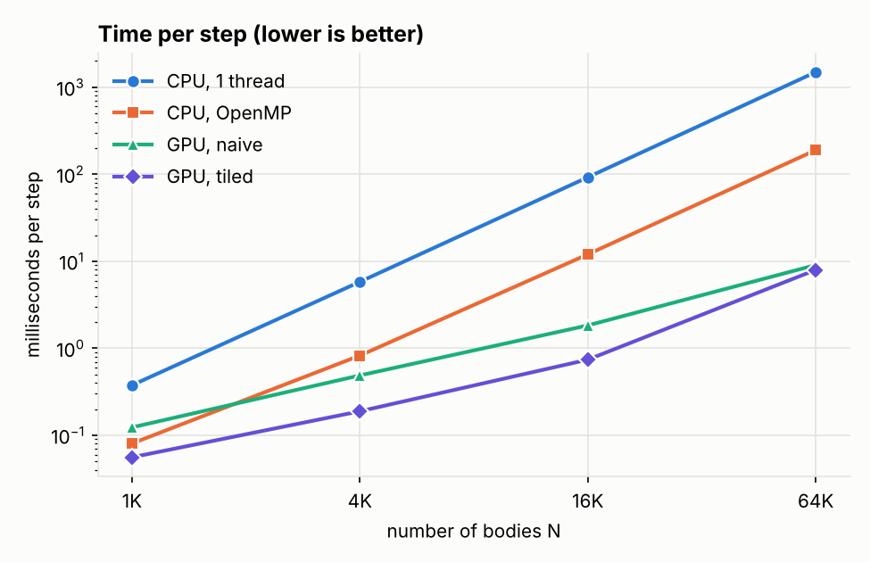
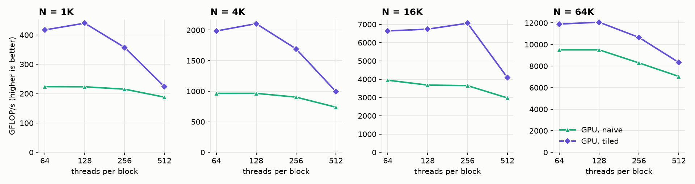
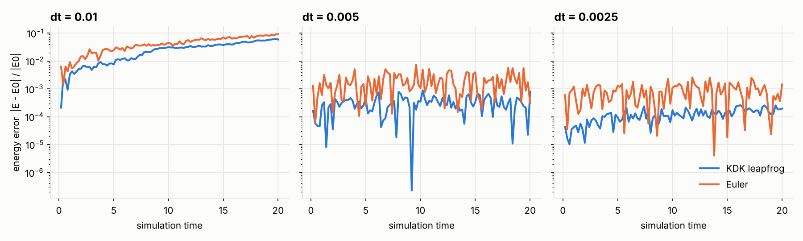
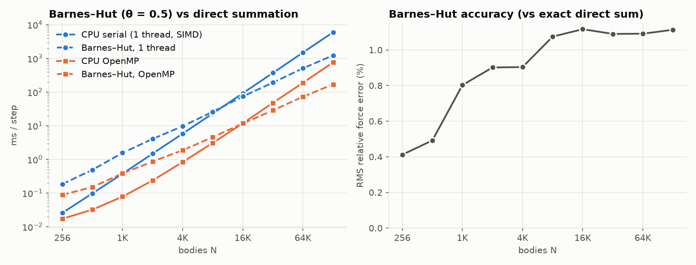

# Benchmark results

_Generated by `scripts/make_report.py` from `results/*.csv` — do not edit by hand._

**Hardware:** CPU x86-64 (model name hidden by the Modal sandbox) [AVX2] (8 threads), GPU NVIDIA A100-SXM4-40GB, 8.0, 610.57.04

### Direct summation: time per step, speedup, throughput

One step = one force evaluation (N² interactions) + one KDK integration kernel. GFLOP/s uses the 20 FLOP/interaction convention. Speedup is against the single-thread CPU code at the same N.

| N | implementation | ms / step | speedup vs serial | interactions / s | GFLOP/s | ΔE/E₀ (run) |
|---|---|--:|--:|--:|--:|--:|
| 1K | CPU serial (1 thread, SIMD) | 0.377 | 1.0× | 2.78 G/s | 55.6 | — |
|  | CPU OpenMP | 0.081 | 4.7× | 13.00 G/s | 260.0 | — |
|  | GPU naive | 0.124 | 3.1× | 8.49 G/s | 169.7 | 1.9e-02 |
|  | GPU tiled (shared mem) | 0.056 | 6.7× | 18.72 G/s | 374.3 | 1.9e-02 |
| 4K | CPU serial (1 thread, SIMD) | 5.815 | 1.0× | 2.88 G/s | 57.7 | — |
|  | CPU OpenMP | 0.826 | 7.0× | 20.31 G/s | 406.2 | — |
|  | GPU naive | 0.489 | 11.9× | 34.34 G/s | 686.7 | 5.2e-03 |
|  | GPU tiled (shared mem) | 0.189 | 30.8× | 88.75 G/s | 1,774.9 | 5.2e-03 |
| 16K | CPU serial (1 thread, SIMD) | 92.4 | 1.0× | 2.91 G/s | 58.1 | — |
|  | CPU OpenMP | 12.0 | 7.7× | 22.32 G/s | 446.4 | — |
|  | GPU naive | 1.834 | 50.4× | 146.36 G/s | 2,927.2 | 5.1e-04 |
|  | GPU tiled (shared mem) | 0.741 | 124.7× | 362.25 G/s | 7,245.0 | 5.1e-04 |
| 64K | CPU serial (1 thread, SIMD) | 1,493.3 | 1.0× | 2.88 G/s | 57.5 | — |
|  | CPU OpenMP | 189.5 | 7.9× | 22.67 G/s | 453.4 | — |
|  | GPU naive | 9.061 | 164.8× | 474.00 G/s | 9,480.0 | 7.5e-04 |
|  | GPU tiled (shared mem) | 7.973 | 187.3× | 538.68 G/s | 10,773.5 | 7.5e-04 |

### GPU block-size sweep

| N | kernel | block 64 | block 128 | block 256 | block 512 |
|---|---|--:|--:|--:|--:|
| 1K | GPU naive | 185 | 188 | 186 | **205** |
| 1K | GPU tiled (shared mem) | 467 | **486** | 407 | 211 |
| 4K | GPU naive | 602 | 741 | **752** | 736 |
| 4K | GPU tiled (shared mem) | 2,059 | **2,164** | 1,784 | 1,019 |
| 16K | GPU naive | **2,972** | 2,539 | 2,349 | 2,224 |
| 16K | GPU tiled (shared mem) | 5,333 | 5,350 | **5,660** | 3,208 |
| 64K | GPU naive | 8,936 | **11,518** | 9,468 | 7,672 |
| 64K | GPU tiled (shared mem) | 11,986 | **12,167** | 10,784 | 8,353 |

GFLOP/s; best block size per row in bold.

### Nsight Compute: naive vs tiled

| metric | GPU naive N=16K | GPU tiled (shared mem) N=16K | GPU naive N=64K | GPU tiled (shared mem) N=64K |
|---|--:|--:|--:|--:|
| kernel time [ns] | 2159200 | 829888 | 9042656 | 10250240 |
| compute throughput (% peak) | 19.46 | 48.83 | 63.20 | 71.92 |
| memory throughput (% peak) | 11.98 | 15.29 | 38.90 | 22.50 |
| DRAM throughput (% peak) | 0.02 | 0.04 | 0.01 | 0.01 |
| L2 traffic [byte] | 19037376 | 18941472 | 140265152 | 277734080 |
| global-load bytes (L1) [byte] | 268959744 | 17301504 | 4297064448 | 270532608 |
| shared-mem wavefronts | 512 | 16916992 | 2048 | 270665728 |
| achieved occupancy (%) | 12.50 | 12.50 | 28.78 | 23.45 |
| theoretical occupancy (%) | 100 | 100 | 100 | 100 |
| registers / thread [register/thread] | 32 | 32 | 32 | 32 |
| stall: long scoreboard (cyc) | — | — | — | — |
| stall: barrier (cyc) | — | — | — | — |

### Energy conservation

| integrator | dt | steps | final ΔE/E₀ | max abs(ΔE/E₀) |
|---|--:|--:|--:|--:|
| KDK leapfrog | 0.01 | 2000 | +5.91e-02 | 6.09e-02 |
| KDK leapfrog | 0.005 | 4000 | -7.94e-04 | 8.86e-04 |
| KDK leapfrog | 0.0025 | 8000 | -1.95e-04 | 2.60e-04 |
| semi-implicit Euler | 0.01 | 2000 | +9.11e-02 | 9.11e-02 |
| semi-implicit Euler | 0.005 | 4000 | +3.04e-04 | 7.33e-03 |
| semi-implicit Euler | 0.0025 | 8000 | +1.43e-03 | 2.58e-03 |

### Barnes–Hut vs direct summation (CPU)

| N | direct, 1 thread | Barnes–Hut, 1 thread | direct, OpenMP | Barnes–Hut, OpenMP | BH force error (RMS) |
|---|--:|--:|--:|--:|--:|
| 256 | 0.026 | 0.184 | 0.017 | 0.089 | 0.41 % |
| 512 | 0.098 | 0.490 | 0.032 | 0.151 | 0.49 % |
| 1K | 0.374 | 1.557 | 0.078 | 0.383 | 0.80 % |
| 2K | 1.479 | 4.057 | 0.236 | 0.861 | 0.90 % |
| 4K | 5.820 | 9.665 | 0.835 | 1.869 | 0.90 % |
| 8K | 23.1 | 26.0 | 3.082 | 4.572 | 1.07 % |
| 16K | 92.2 | 73.9 | 11.8 | 11.7 | 1.12 % |
| 32K | 369.4 | 190.8 | 47.6 | 28.5 | 1.09 % |
| 64K | 1,490.6 | 506.9 | 189.0 | 72.6 | 1.09 % |
| 128K | 5,956.8 | 1,226.5 | 755.9 | 168.5 | 1.11 % |

ms per step. **Crossover** (Barnes–Hut faster than direct summation on the same threads): 1 thread **N ≈ 10,459**, OpenMP **N ≈ 16,122**.

