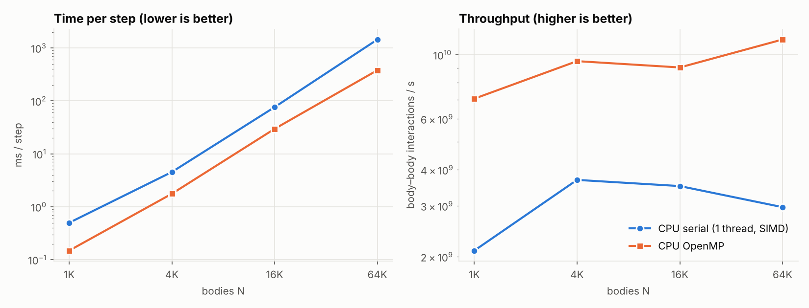
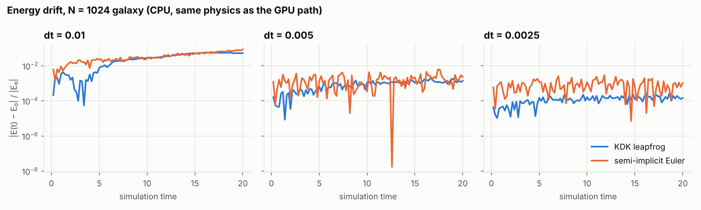
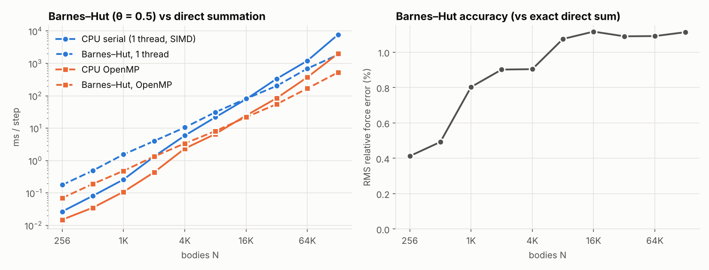

# Benchmark results

_Generated by `scripts/make_report.py` from `results/*.csv` — do not edit by hand._

**Hardware:** CPU Intel(R) Xeon(R) Processor @ 2.10GHz (4 threads), GPU: _not measured yet_

### Direct summation: time per step, speedup, throughput

One step = one force evaluation (N² interactions) + one KDK integration kernel. GFLOP/s uses the 20 FLOP/interaction convention. Speedup is against the single-thread CPU code at the same N.

| N | implementation | ms / step | speedup vs serial | interactions / s | GFLOP/s | ΔE/E₀ (run) |
|---|---|--:|--:|--:|--:|--:|
| 1K | CPU serial (1 thread, SIMD) | 0.499 | 1.0× | 2.10 G/s | 42.0 | — |
|  | CPU OpenMP | 0.149 | 3.4× | 7.05 G/s | 140.9 | — |
|  | GPU naive | — | — | — | — | — |
|  | GPU tiled (shared mem) | — | — | — | — | — |
| 4K | CPU serial (1 thread, SIMD) | 4.547 | 1.0× | 3.69 G/s | 73.8 | — |
|  | CPU OpenMP | 1.765 | 2.6× | 9.50 G/s | 190.1 | — |
|  | GPU naive | — | — | — | — | — |
|  | GPU tiled (shared mem) | — | — | — | — | — |
| 16K | CPU serial (1 thread, SIMD) | 76.4 | 1.0× | 3.51 G/s | 70.2 | — |
|  | CPU OpenMP | 29.7 | 2.6× | 9.04 G/s | 180.7 | — |
|  | GPU naive | — | — | — | — | — |
|  | GPU tiled (shared mem) | — | — | — | — | — |
| 64K | CPU serial (1 thread, SIMD) | 1,446.5 | 1.0× | 2.97 G/s | 59.4 | — |
|  | CPU OpenMP | 380.4 | 3.8× | 11.29 G/s | 225.8 | — |
|  | GPU naive | — | — | — | — | — |
|  | GPU tiled (shared mem) | — | — | — | — | — |

### GPU block-size sweep

_Not measured yet — run `scripts/run_benchmarks.sh` on a machine with an NVIDIA GPU._

### Nsight Compute: naive vs tiled

_Not measured yet — run `scripts/profile_ncu.sh` on a machine with an NVIDIA GPU and Nsight Compute._

### Energy conservation

| integrator | dt | steps | final ΔE/E₀ | max abs(ΔE/E₀) |
|---|--:|--:|--:|--:|
| KDK leapfrog | 0.01 | 2000 | +5.30e-02 | 5.78e-02 |
| KDK leapfrog | 0.005 | 4000 | -1.38e-03 | 1.93e-03 |
| KDK leapfrog | 0.0025 | 8000 | -1.45e-04 | 2.69e-04 |
| semi-implicit Euler | 0.01 | 2000 | +8.56e-02 | 8.56e-02 |
| semi-implicit Euler | 0.005 | 4000 | -2.32e-03 | 6.12e-03 |
| semi-implicit Euler | 0.0025 | 8000 | -1.04e-03 | 2.85e-03 |

### Barnes–Hut vs direct summation (CPU)

| N | direct, 1 thread | Barnes–Hut, 1 thread | direct, OpenMP | Barnes–Hut, OpenMP | BH force error (RMS) |
|---|--:|--:|--:|--:|--:|
| 256 | 0.027 | 0.177 | 0.015 | 0.070 | 0.41 % |
| 512 | 0.082 | 0.491 | 0.035 | 0.191 | 0.49 % |
| 1K | 0.261 | 1.551 | 0.109 | 0.482 | 0.80 % |
| 2K | 1.337 | 4.025 | 0.436 | 1.339 | 0.90 % |
| 4K | 5.928 | 10.5 | 2.356 | 3.391 | 0.90 % |
| 8K | 21.9 | 31.3 | 6.660 | 8.162 | 1.07 % |
| 16K | 78.6 | 81.4 | 24.6 | 21.9 | 1.12 % |
| 32K | 337.3 | 203.0 | 85.0 | 55.4 | 1.09 % |
| 64K | 1,212.4 | 695.3 | 374.6 | 169.0 | 1.09 % |
| 128K | 7,753.0 | 1,851.6 | 2,006.4 | 527.8 | 1.11 % |

ms per step. **Crossover** (Barnes–Hut faster than direct summation on the same threads): 1 thread **N ≈ 17,118**, OpenMP **N ≈ 12,711**.

